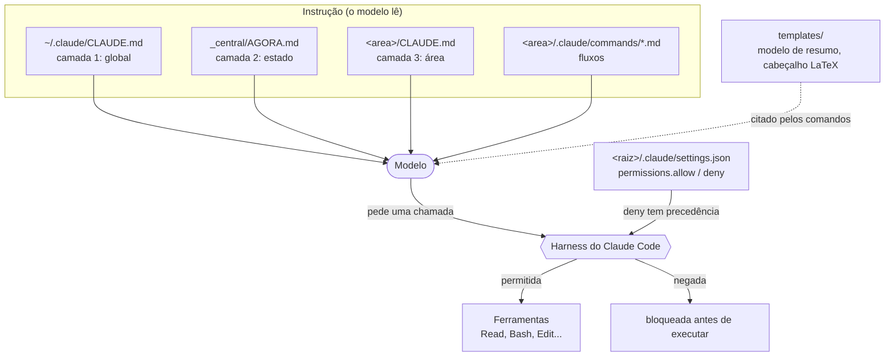
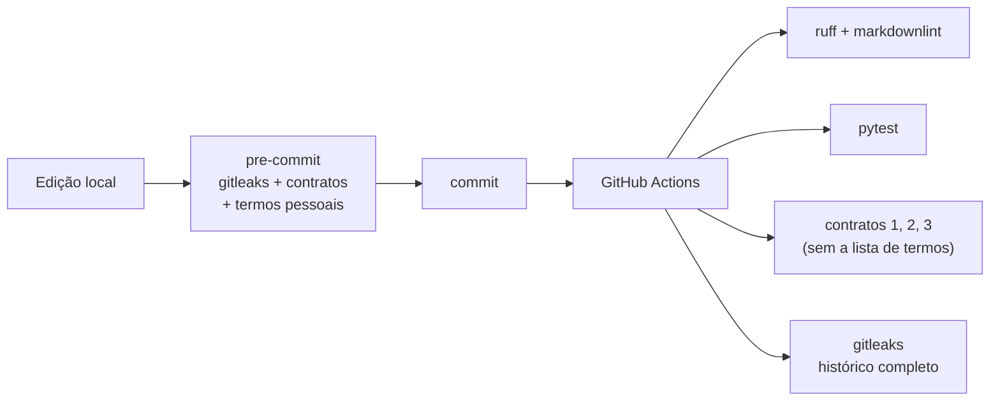

# Arquitetura

Este repositório tem duas partes: a **configuração** do Claude Code para estudo (comandos, templates, permissões) e os **validadores** que garantem que essa configuração continua correta e sem dados pessoais.

## Camadas de contexto

O Claude Code monta o contexto de cada sessão juntando arquivos de instrução, do mais geral para o mais específico. Cada camada tem uma fonte da verdade e muda num ritmo diferente.

| Camada | Arquivo | Conteúdo | Muda quando |
|---|---|---|---|
| 1. Global | `~/.claude/CLAUDE.md` | quem sou, como trabalhar, regras de segurança | raramente |
| 2. Estado | `_central/AGORA.md` | prazos, frentes ativas, pendências | toda semana |
| 3. Área | `<area>/CLAUDE.md` | pastas, nomes, fontes da área (ver `templates/`) | a cada decisão |
| Fluxos | `<area>/.claude/commands/*.md` | `/resumo`, `/modulo`, `/fechamento`... (ver `commands/`) | ao ajustar um fluxo |
| Permissão | `<raiz>/.claude/settings.json` | allow mínimo + deny de segredos (ver `settings/`) | ao mudar a política |

As camadas 1 a 3 e os fluxos são **instrução**: o modelo lê e decide seguir. A camada de permissão é **imposta** pelo harness antes de a ferramenta executar ([ADR-0001](adr/0001-instrucao-vs-permissao.md)).

## Validação (policy as code)

Os arquivos de configuração deste repositório são tratados como código: têm contrato, teste e gate no CI.

| Contrato | Script | O que impede |
|---|---|---|
| 1. Frontmatter dos comandos | `scripts/validate_commands.py` | comando sem `description` (some do menu `/`), `$ARGUMENTS` sem `argument-hint`, YAML inválido |
| 2. Política de permissões | `scripts/validate_settings.py` | `deny` que deixou de cobrir `.env`, `*.tfvars`, `*.pem`, `*.key` ou `find -exec`/`-delete`; curinga no `allow` |
| 3. Gate de privacidade | `scripts/check_privacy.py` | caminho de usuário, e-mail ou termo pessoal num arquivo do repositório ([ADR-0002](adr/0002-gate-de-privacidade-local.md)) |

Todos os scripts usam o mesmo protocolo: uma violação por linha no formato `arquivo:linha: mensagem` e código de saída `1` se houver violação (`0` ok, `2` erro de uso). Isso faz o CI falhar e deixa o erro clicável no editor.

Cada contrato tem testes com casos que **passam** e casos que **falham** (`tests/fixtures/`, todos fictícios). Um teste extra garante que toda fixture inválida tem um caso de teste correspondente, para não existir fixture esquecida.
